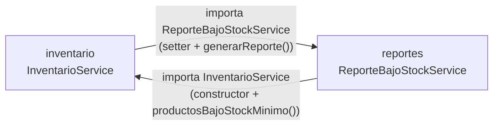
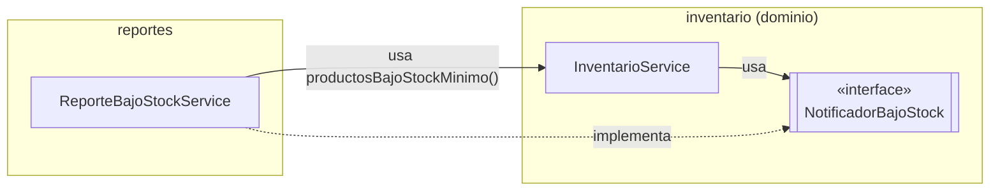

# rincon-post1-u11

Post-contenido de la Unidad 11 (Patrones de Diseño de Software, UFPS): **Refactorización guiada por pruebas: code smells, paquetes y acoplamiento en un proyecto Java real**.

- **Repositorio:** https://github.com/DavidRincon12/rincon-post1-u11
- **Autor:** David Santiago Rincón Bautista

## Cómo ejecutar

Requisitos: Java 17 o superior y Maven 3.9 o superior.

```bash
mvn test                                  # suite completa
mvn test -Dtest=ArquitecturaPaquetesTest  # solo la prueba de arquitectura
```

## Estructura

```
pom.xml
src/main/java/com/universidad/refactoringu11/
├── RefactoringU11Application.java
├── inventario/                        dominio (mayor nivel de abstracción)
│   ├── TipoProducto.java              enum con el comportamiento por tipo
│   ├── Producto.java
│   ├── InventarioService.java         actualizarInventario descompuesto
│   ├── ClasificadorProducto.java      delega en TipoProducto
│   ├── EtiquetadoProducto.java        delega en TipoProducto
│   └── NotificadorBajoStock.java      puerto que implementa reportes
└── reportes/
    └── ReporteBajoStockService.java   implementa NotificadorBajoStock
src/test/java/com/universidad/refactoringu11/
├── ArquitecturaPaquetesTest.java      ArchUnit: paquetes sin ciclos
├── RefactoringU11ApplicationTests.java
├── inventario/                        pruebas de caracterización + notificación
└── reportes/                          pruebas del reporte
```

---

# Parte 1: red de seguridad y refactorización guiada por evidencia

## Historia de commits de la Parte 1

| Paso | Commit |
|---|---|
| 1 | `feat: crear inventario con Long Method en InventarioService y switch duplicado en Clasificador/Etiquetado` |
| 2 | `test: agregar pruebas de caracterizacion antes de refactorizar (red de seguridad)` |
| 3 | `refactor: eliminar Long Method en actualizarInventario descomponiendo responsabilidades` |
| 4 | `refactor: eliminar switch duplicado sobre TipoProducto con polimorfismo` |
| 5 | `docs: documentar evidencia de code smells, decisiones de diseno y resultado de pruebas` |

## Pruebas de caracterización (Paso 2)

Se escribieron y se corrieron en verde **sobre el código original**, antes de tocar `InventarioService`, `ClasificadorProducto` o `EtiquetadoProducto`. Se instancian con `new`, sin levantar Spring.

| Clase de prueba | Pruebas | Qué fija |
|---|---|---|
| `InventarioServiceTest` | 10 | Los 4 tipos de retorno (`OK_n`, `ERROR_DATOS_INVALIDOS`, `ERROR_STOCK_INSUFICIENTE`, `OK_BAJO_STOCK_REORDEN_n`), `ERROR_PRODUCTO_NO_EXISTE` y los casos límite: `productoId` nulo, cantidad 0, stock que queda justo en el mínimo (sin reorden) y stock que queda en 0 |
| `ClasificadorProductoTest` | 4 | Recargo de las 4 ramas: LIBRO, ELECTRONICO, ROPA y ALIMENTO |
| `EtiquetadoProductoTest` | 4 | Etiqueta de las 4 ramas |
| `RefactoringU11ApplicationTests` | 1 | El contexto de Spring arranca |

Ninguna de estas pruebas se modificó después de su commit (`git diff <commit de pruebas> HEAD -- src/test/java/com/universidad/refactoringu11/inventario` sale vacío).

## Smell 1: Long Method en `InventarioService.actualizarInventario()`

**Técnica elegida:** *Extract Method* (composición de métodos, Fowler), más *Replace Magic Literal* para `"ENTRADA"`, `"SALIDA"` y el factor `3`.

| Métrica | Antes | Después |
|---|---|---|
| Líneas del método (firma y llave incluidas) | 44 | 11 (9 de cuerpo) |
| Responsabilidades mezcladas en el método | 5 (validar, buscar, actualizar stock, calcular reorden, registrar/alertar) | 1 (orquestar) |
| Complejidad ciclomática del método | 12 | 4 |
| Métodos privados con nombre que revela intención | 0 | 8 |

Después, `actualizarInventario` solo orquesta:

```java
public String actualizarInventario(Long productoId, int cantidad, String tipoMovimiento) {
    if (!esSolicitudValida(productoId, cantidad, tipoMovimiento)) return "ERROR_DATOS_INVALIDOS";
    Optional<Producto> encontrado = buscarProducto(productoId);
    if (encontrado.isEmpty()) return "ERROR_PRODUCTO_NO_EXISTE";
    Producto producto = encontrado.get();
    int nuevoStock = calcularNuevoStock(producto, cantidad, tipoMovimiento);
    if (nuevoStock < 0) return "ERROR_STOCK_INSUFICIENTE";
    producto.setStock(nuevoStock);
    registrarMovimiento(producto, cantidad, tipoMovimiento);
    return resultadoConAlerta(producto);
}
```

Métodos extraídos, uno por responsabilidad: `esSolicitudValida`, `buscarProducto`, `calcularNuevoStock`, `registrarMovimiento`, `resultadoConAlerta`, `necesitaReorden`, `calcularCantidadReorden` y `alertarBajoStock`.

Un efecto lateral: la validación original llamaba `tipoMovimiento.equals(...)` y lanzaba `NullPointerException` con un tipo nulo. Ahora se usa `ENTRADA.equals(tipoMovimiento)`, que devuelve `ERROR_DATOS_INVALIDOS`. Es el único cambio observable, solo afecta una entrada que antes reventaba y ninguna prueba de caracterización dependía de él.

### Decisión de diseño 1: la cantidad de reorden queda como método privado

`calcularCantidadReorden` (y `necesitaReorden`) se extrajeron como **métodos privados de `InventarioService`**, no como una clase `CalculadoraReorden`.

- Hoy la regla es una línea (`stockMinimo * 3 - stock`), sin estado ni colaboradores, y solo la usa este servicio.
- No tiene una razón de cambio propia todavía: el factor de reorden cambia cuando cambia la política de inventario, que es justamente la responsabilidad de este servicio.
- Una clase aparte agregaría un archivo, una dependencia y su cableado en Spring sin resolver ningún problema actual (YAGNI).
- **Cuándo cambiar:** si aparecen varias políticas de reorden (por proveedor, por temporada o por tipo de producto), o si la regla necesita datos externos como el histórico de ventas, se extrae a `CalculadoraReorden` (o a un Strategy). Como ya vive en un método con nombre propio, la extracción es mecánica.

## Smell 2: Switch Statements duplicados en `ClasificadorProducto` y `EtiquetadoProducto`

**Técnica elegida:** *Replace Conditional with Polymorphism* (Fowler), en su variante de `enum` con métodos abstractos.

**Evidencia antes:** el mismo `switch (producto.getTipo())` con las mismas 4 ramas (LIBRO, ELECTRONICO, ROPA, ALIMENTO) y el mismo `default` que lanza `IllegalArgumentException` aparecía en las dos clases:

| Clase | Líneas del switch | Ramas |
|---|---|---|
| `ClasificadorProducto.calcularRecargoEnvio` | 9 | 4 + default |
| `EtiquetadoProducto.generarEtiqueta` | 9 | 4 + default |

La estructura condicional era idéntica en un 100 % (las 6 líneas `switch`/`default`/`throw` y las 4 etiquetas `case`); solo cambiaba la expresión de cada rama. Agregar un tipo obligaba a editar las dos clases y nada lo forzaba: el olvido se descubría en ejecución, con el `default`.

**Evidencia después:**

```bash
$ grep -rnE "switch|case (LIBRO|ELECTRONICO)|if.*getTipo" src/main
(sin resultados)
```

```java
public double calcularRecargoEnvio(Producto producto) {
    return producto.getTipo().recargoEnvio(producto.getPrecio());
}

public String generarEtiqueta(Producto producto) {
    return producto.getTipo().etiqueta(producto.getNombre());
}
```

Cada constante de `TipoProducto` implementa `recargoEnvio(double)` y `etiqueta(String)`. Las dos firmas públicas originales se conservan. Agregar un tipo nuevo solo toca `TipoProducto`, y el compilador exige que implemente ambos métodos.

### Decisión de diseño 2: `enum` con métodos abstractos en lugar de interfaz Strategy

- **El conjunto de tipos es cerrado y estable** en este dominio: el `enum` ya existía, ya era la fuente de verdad y el compilador obliga a cada constante nueva a implementar todo el comportamiento. Con una interfaz Strategy se necesitaría, además, un mapa o una fábrica `TipoProducto → estrategia` que se puede olvidar de actualizar.
- **Costo menor:** 0 clases nuevas, frente a 1 interfaz y 4 implementaciones (más su registro) con Strategy.
- **El comportamiento es puro:** cálculo y formato a partir del precio y el nombre, sin colaboradores.
- **Cuándo cambiar:** si un tipo necesitara colaboradores inyectados por Spring (por ejemplo, un servicio de tarifas de envío o de impuestos), las constantes de un `enum` no pueden recibir inyección. Ahí conviene migrar a una interfaz `PoliticaProducto` con un `@Component` por tipo y un registro `Map<TipoProducto, PoliticaProducto>`. Como los clientes ya delegan en una sola llamada, el cambio quedaría contenido.

## Resultado de `mvn test` en la Parte 1

| Momento | Pruebas | Resultado |
|---|---|---|
| Código original (Paso 2) | 19 | `Tests run: 19, Failures: 0, Errors: 0, Skipped: 0` · BUILD SUCCESS |
| Tras eliminar el Long Method (Paso 3) | 19 | `Tests run: 19, Failures: 0, Errors: 0, Skipped: 0` · BUILD SUCCESS |
| Tras eliminar el switch (Paso 4) | 19 | `Tests run: 19, Failures: 0, Errors: 0, Skipped: 0` · BUILD SUCCESS |

Desglose: 10 de `InventarioServiceTest`, 4 de `ClasificadorProductoTest`, 4 de `EtiquetadoProductoTest` y 1 de `RefactoringU11ApplicationTests`.

---

# Parte 2: diagnóstico y resolución del acoplamiento entre paquetes

## Diagnóstico: ciclo `inventario` ↔ `reportes`

Al integrar `reportes.ReporteBajoStockService`, `InventarioService` empezó a importar `ReporteBajoStockService` para avisarle del bajo stock, y `ReporteBajoStockService` ya importaba `InventarioService` para recorrer los productos bajo el mínimo. El proyecto compila y todas las pruebas de negocio siguen en verde, pero los paquetes quedan con un ciclo:



`ArquitecturaPaquetesTest` lo detecta (`mvn test -Dtest=ArquitecturaPaquetesTest`, salida recortada):

```
[ERROR] Tests run: 1, Failures: 1, Errors: 0, Skipped: 0
Architecture Violation [Priority: MEDIUM] - Rule 'slices matching 'com.universidad.refactoringu11.(*)..' should be free of cycles' was violated (1 times):
Cycle detected: Slice inventario ->
                Slice reportes ->
                Slice inventario
  1. Dependencies of Slice inventario
    - Field <...inventario.InventarioService.reporteBajoStockService> has type <...reportes.ReporteBajoStockService>
    - Method <...inventario.InventarioService.setReporteBajoStockService(...reportes.ReporteBajoStockService)> has parameter of type <...reportes.ReporteBajoStockService>
    - Method <...inventario.InventarioService.alertarBajoStock(...)> calls method <...reportes.ReporteBajoStockService.generarReporte()>
  2. Dependencies of Slice reportes
    - Constructor <...reportes.ReporteBajoStockService.<init>(...inventario.InventarioService)> has parameter of type <...inventario.InventarioService>
    - Method <...reportes.ReporteBajoStockService.generarReporte()> calls method <...inventario.InventarioService.productosBajoStockMinimo()>
    ...
```

Mientras tanto, las pruebas de negocio de la Parte 1 siguen en verde (`InventarioServiceTest` 10/10, `ClasificadorProductoTest` 4/4, `EtiquetadoProductoTest` 4/4). Esa es la evidencia de que el problema es de arquitectura y no de comportamiento: un code smell no es un bug.

### Un segundo ciclo: el de los beans de Spring

Al integrar el módulo, `RefactoringU11ApplicationTests.contextLoads` falló con `BeanCurrentlyInCreationException`: `inventarioService` pedía por setter a `reporteBajoStockService`, que pedía por constructor a `inventarioService`, que seguía en creación. Desde la versión 2.6, Spring Boot prohíbe las referencias circulares entre beans. Este ciclo es de **objetos en tiempo de ejecución**, no de paquetes, y sigue existiendo después de invertir la dependencia de paquetes, porque el reporte necesita al inventario y el inventario necesita al notificador. Se resolvió con `@Lazy` en el parámetro del constructor de `ReporteBajoStockService`: Spring inyecta un proxy diferido y el ciclo de creación desaparece sin cambiar el comportamiento.

## Resolución: inversión de dependencias con `NotificadorBajoStock`

Se aplicó el principio de Inversión de Dependencias. `inventario` define la abstracción que necesita, `NotificadorBajoStock.notificar(Producto, int cantidadReorden)`, y `reportes` la implementa:



Ahora todas las flechas entre paquetes van de `reportes` hacia `inventario`, la única dirección permitida.

| Antes | Después |
|---|---|
| `inventario → reportes` (import de `ReporteBajoStockService`) y `reportes → inventario` | solo `reportes → inventario` |
| `InventarioService.setReporteBajoStockService(ReporteBajoStockService)` | `InventarioService.setNotificador(NotificadorBajoStock)` |
| `ArquitecturaPaquetesTest`: **FAIL** (`Cycle detected: Slice inventario -> Slice reportes -> Slice inventario`) | `ArquitecturaPaquetesTest`: **PASS** |

```bash
$ grep -rn "reportes" src/main/java/com/universidad/refactoringu11/inventario/
(sin resultados)

$ mvn test -Dtest=ArquitecturaPaquetesTest
[INFO] Tests run: 1, Failures: 0, Errors: 0, Skipped: 0
[INFO] BUILD SUCCESS
```

`ReporteBajoStockService.notificar` guarda cada alerta, y `generarReporte()` lista los productos bajo el mínimo (los toma de `InventarioService.productosBajoStockMinimo()`) seguidos de las alertas de reorden recibidas.

## Confirmación: el comportamiento observable no cambió

Las pruebas de caracterización de la Parte 1 se volvieron a ejecutar **sin modificar una sola línea**. `git diff b5d39d5 HEAD` sobre `InventarioServiceTest`, `ClasificadorProductoTest` y `EtiquetadoProductoTest` sale vacío.

```
$ mvn test
[INFO] Tests run: 1,  ... -- in com.universidad.refactoringu11.ArquitecturaPaquetesTest
[INFO] Tests run: 4,  ... -- in com.universidad.refactoringu11.reportes.ReporteBajoStockServiceTest
[INFO] Tests run: 1,  ... -- in com.universidad.refactoringu11.RefactoringU11ApplicationTests
[INFO] Tests run: 3,  ... -- in com.universidad.refactoringu11.inventario.InventarioNotificacionTest
[INFO] Tests run: 10, ... -- in com.universidad.refactoringu11.inventario.InventarioServiceTest
[INFO] Tests run: 4,  ... -- in com.universidad.refactoringu11.inventario.ClasificadorProductoTest
[INFO] Tests run: 4,  ... -- in com.universidad.refactoringu11.inventario.EtiquetadoProductoTest
[INFO] Tests run: 27, Failures: 0, Errors: 0, Skipped: 0
[INFO] BUILD SUCCESS
```

| Momento | `ArquitecturaPaquetesTest` | Pruebas de la Parte 1 (18) | Total |
|---|---|---|---|
| Tras agregar `reportes` (ciclo presente) | FAIL | 18/18 en verde | 21 de negocio en verde + 1 de arquitectura en rojo |
| Tras invertir la dependencia | PASS | 18/18 en verde | 27/27 en verde |

Las pruebas nuevas de la Parte 2 son `ReporteBajoStockServiceTest` (4) e `InventarioNotificacionTest` (3: notifica una sola vez con la cantidad de reorden y no notifica sin bajo stock ni con un movimiento rechazado). No reemplazan a las de caracterización: las complementan.

### Decisión de diseño 3: `NotificadorBajoStock` vive en `inventario`

La regla de la Guía de Contenido (sección 4.3) dice: *"los paquetes de infraestructura dependen de dominio; dominio nunca depende de infraestructura"*.

- **`inventario` es el paquete de mayor nivel de abstracción.** Contiene las reglas del negocio: stock, mínimos, reorden y tipos de producto. `reportes` es un detalle de presentación y salida que podría cambiar a correo, a Slack o a un PDF sin que cambie una sola regla de inventario.
- **La interfaz pertenece a quien la necesita (su cliente), no a quien la implementa.** `InventarioService` es quien declara "necesito avisarle a alguien del bajo stock", así que el contrato lo define el dominio, con sus propios tipos (`Producto`, `int`).
- **Si la interfaz viviera en `reportes`, el ciclo seguiría:** `inventario` importaría `reportes.NotificadorBajoStock` y `reportes` seguiría importando `inventario.InventarioService`. Solo cambiaría la clase que forma el ciclo, no el ciclo.
- Ubicada en `inventario`, se pueden agregar implementaciones nuevas (un notificador por correo, una cola) en otros paquetes sin tocar el dominio.

### Decisión de diseño 4: notificación por evento individual

Se eligió `notificar(Producto, int cantidadReorden)`, que se llama una vez por cada movimiento que deja un producto bajo el mínimo, en lugar de una notificación por lote como `notificar(List<Producto>)`.

- **Encaja con cómo se detecta el problema:** `actualizarInventario` procesa un movimiento a la vez y en ese instante sabe exactamente qué producto cruzó el mínimo y cuántas unidades reordenar. Un lote obligaría a acumular estado dentro del servicio y a decidir cuándo "cerrar" el lote, una responsabilidad nueva que nadie pidió.
- **Inmediatez y precisión:** la alerta sale en el momento del movimiento y lleva la cantidad de reorden ya calculada, así que el notificador no tiene que recalcular la regla de negocio. Con `List<Producto>` esa cantidad se perdería o habría que duplicar la fórmula fuera del dominio.
- **Contrato mínimo y fácil de probar:** se implementa con una lambda (así lo hace `InventarioNotificacionTest`).
- **Cuándo preferiría el lote:** cuando el aviso es costoso o ruidoso por evento. Por ejemplo, una carga masiva o un cierre de inventario nocturno que mueve miles de productos (una alerta por producto inundaría el canal), un resumen diario para compras o un proveedor externo con límite de llamadas por minuto. En ese caso se agregaría un método por lote, o un notificador que agrupe los eventos individuales, sin cambiar el dominio.

---

## Resumen de cumplimiento

| Requisito | Dónde se ve |
|---|---|
| Pruebas de caracterización antes de refactorizar y sin modificar | Commit `test: agregar pruebas de caracterizacion…`, anterior a los dos `refactor:` de la Parte 1 |
| Long Method eliminado (`actualizarInventario` ≤ 10 líneas) | 9 líneas de cuerpo, 8 métodos extraídos |
| Sin `switch` ni `if-else` sobre `TipoProducto` | `grep` vacío; `enum` con métodos abstractos |
| Ciclo detectado por ArchUnit y luego resuelto | Commit de la prueba en rojo seguido del commit `refactor: invertir la dependencia…` |
| `inventario` no importa `reportes` | `grep` vacío |
| 4 decisiones de diseño justificadas | Decisiones 1 y 2 (Parte 1), 3 y 4 (Parte 2) |
